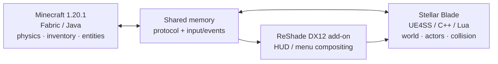

<div align="center">

# StellarCraft

### Minecraft gameplay, inside the world of Stellar Blade.

**Keep Stellar Blade's world. Play by Minecraft's rules.**

> 🤖 **Created by OpenAI Codex.** StellarCraft is an AI-created project developed with Codex, with its goals, direction, and in-game testing guided by the project maintainer.

[](https://github.com/Slime11123/StellarCraft)
[](https://www.minecraft.net/)
[](https://fabricmc.net/)
[](https://github.com/Slime11123/StellarCraft)
[](LICENSE)

**English** · [简体中文](README.zh-CN.md)

[Features](#features) · [Screenshots](#screenshots) · [Requirements](#requirements) · [Installation](#installation--developer-setup) · [Roadmap](#roadmap) · [Building](#building-from-source)

</div>

---

## What is StellarCraft?

**StellarCraft** is an experimental integration that brings Minecraft's player systems into **Stellar Blade** on PC. Switch between Eve and Minecraft-style control, use a Minecraft inventory and HUD, move with Minecraft-inspired rules, and interact with blocks and selected entities within Stellar Blade's world.

Neither game is replaced or recreated. A **Minecraft Fabric mod**, a **Stellar Blade-side UE4SS/C++ integration**, and a **ReShade DirectX 12 add-on** coordinate through a shared-memory protocol. Minecraft supplies gameplay state; Stellar Blade remains the world and presentation environment.

> [!IMPORTANT]
> **Early alpha / research project — not a plug-and-play release.** Features described below have different validation levels, and there is currently no packaged public installer. Back up game saves before testing. This project is not affiliated with SHIFT UP, Sony, Mojang or Microsoft, and users must own their games.

## Screenshots

| Minecraft UI composited in Stellar Blade | Native rendering experiment |
|:---:|:---:|
|  |  |

<sub>Captured during local development/testing. Visuals may differ from current builds. More gameplay footage will be added as features stabilize.</sub>

## Features

The following statuses reflect project documentation and local testing through **October 11, 2026**.

| System | Status | Current scope |
|---|---|---|
| Eve / Minecraft control switching | ✅ Tested | Switch between modes with **F4**, including returning to Eve. |
| Minecraft movement | ✅ Tested | Walking, jumping, crouching, creative flight and tested stair/terrain traversal. |
| Minecraft HUD & inventory | ✅ Tested | DirectX 12 in-process compositing, menus, hotbar and mouse interaction. |
| Blocks in Stellar Blade | ✅ Tested | Place selected blocks; native geometry, pixel textures and persistence for registered blocks. |
| Lighting & Ender Pearls | ✅ Tested | Torch/glowstone lighting and safe pearl teleportation in tested scenes. |
| TNT effects | ✅ Partial | Priming, explosion particles and interactions with registered Minecraft blocks/entities tested; reliable damage to actual Stellar Blade enemies needs more verification. |
| Selected Minecraft entities | 🧪 Partial | Pig and oak boat rendering demonstrated; full vanilla mob AI and water/boat physics are not supported yet. |
| Cross-game damage | 🧪 Partial | Player damage-mode rules tested locally; broader combat interactions still need validation. |
| Character/hand visuals | 🛠 In progress | Texture, animation and synchronization issues remain. |
| Map transitions and stability | 🛠 In progress | Some transitions with Minecraft active and some exit paths can crash. |
| Elytra, advanced projectiles & full entity parity | 📋 Planned | Not ready as fully implemented features. |

**Scope note:** Benchmarks and functional tests were performed in specific scenes only; they are not guarantees of general performance or stability.

## Requirements

| Component | Development environment / notes |
|---|---|
| Operating system | Windows, x64 |
| Stellar Blade | PC version; launch and test through your own legitimate installation |
| Minecraft | **Java Edition 1.20.1** |
| Mod loader | **Fabric Loader 0.19.5** |
| Fabric API | **0.92.2+1.20.1** |
| Java | **JDK 21** for current source/build configuration |
| Graphics integration | DirectX 12; compatible **ReShade add-on runtime** (tested with 6.8.0) |
| Native integration | Compatible UE4SS setup; locally generated SDK headers may be needed for a full native build |
| C++ development | Visual Studio 2022 C++ tools; xmake for the native project |

> [!CAUTION]
> Native game hooks and injected add-ons can conflict with game updates, anti-cheat software or other mods, and may violate applicable terms. Use at your own risk; do not test with irreplaceable saves. No game executables, proprietary game assets or extracted Stellar Blade SDK headers are distributed here.

## Installation / Developer Setup

**There is no public one-click package yet.** These are development-oriented steps, not a guarantee of a working installation on a clean PC.

1. **Back up** Stellar Blade saves and your Minecraft worlds. Keep the original game files available for restoration.
2. Install **Minecraft Java 1.20.1**, **Fabric Loader 0.19.5**, **Fabric API 0.92.2+1.20.1**, and **Java 21**.
3. Clone this repository, including MinHook:

   ```powershell
   git clone --recurse-submodules https://github.com/Slime11123/StellarCraft.git
   cd StellarCraft
   ```

4. Build the Fabric mod and the ReShade add-on using the instructions below. Native integration requires a compatible locally configured UE4SS environment.
5. Follow [the ReShade add-on deployment and verification notes](sb-mod/reshade-addon/README.md) to configure the compatible ReShade **add-on** runtime, shader and mod components. Paths in that document are examples from a developer machine, **not** universal install locations.
6. On a properly configured development setup, start the Minecraft instance and launch Stellar Blade through Steam. Use **F4** to change modes.

If a build or launch step fails, consult the [current project state](CURRENT_STATE.md), [design document](docs/DESIGN.md), and [issue tracker](https://github.com/Slime11123/StellarCraft/issues). The project does not yet provide fully reproducible end-user packaging.

## Controls

| Key | Function |
|---|---|
| **F4** | Switch between Eve mode and Minecraft mode |
| **E** | Open/close Minecraft inventory while in Minecraft mode |
| **Esc** | Back out of Minecraft screens / context-dependent menu control |
| **Shift** | Minecraft crouch while controlling the Minecraft player |
| **F5** | Minecraft camera perspective control (behavior may vary by current integration) |
| Minecraft movement keys | Standard configured Minecraft controls in Minecraft mode |

## How it works



The game-facing renderer uses native Stellar Blade geometry where implemented, while the ReShade add-on composites Minecraft UI inside the game's DirectX 12 frame. This is an **in-process** approach; the older external transparent-window overlay is no longer the active architecture.

Read [the technical design](docs/DESIGN.md) for coordinate mapping, entity bridging, collisions, rendering and authority rules.

## Building from source

**Minecraft Fabric mod** (Windows PowerShell, JDK 21):

```powershell
cd mc-mod
.\gradlew.bat build
```

> A complete clean-machine Gradle build has not been consistently verified in the recorded Windows environment. Some local development builds used an incremental/remapping script. Do not assume the above command succeeds on every system yet.

**ReShade DirectX 12 add-on** (Visual Studio 2022 C++ toolchain):

```powershell
cd sb-mod\reshade-addon
.\build.bat
```

**Stellar Blade-side native project** (xmake and VS 2022; development scaffold):

```powershell
cd sb-mod
xmake f -m release
xmake
```

The native xmake target has an optional SDK-dependent configuration. **The generated Stellar Blade SDK is intentionally not part of this repository**; a successful SDK-free scaffold build does not imply full gameplay integration. Refer to [sb-mod/xmake.lua](sb-mod/xmake.lua).

## Repository layout

| Directory | Purpose |
|---|---|
| [`mc-mod/`](mc-mod/) | Minecraft Fabric Java mod, JNI bridge, rendering/movement hooks and tests |
| [`sb-mod/`](sb-mod/) | Stellar Blade-side C++ and Lua, ReShade add-on, native tests |
| [`protocol/`](protocol/) | Shared-memory layout and cross-process protocol |
| [`docs/`](docs/) | Design, repair plans and test/verification notes |
| [`tools/`](tools/) | Developer utilities, probes and regression tests |
| `stellarcraft-mcmod-forge-源码交付包/` | Experimental Forge migration source snapshot; **not** the maintained primary runtime |

## Roadmap

- [x] Establish shared-memory protocol and in-process DX12 UI composition
- [x] Demonstrate Eve/Minecraft mode switching, Minecraft inventory and block placement
- [x] Demonstrate selected native entities, lighting, pearls and TNT particles
- [ ] Fix remaining player/entity textures, hands and animation smoothness
- [ ] Improve mob knockback, bow/projectile rendering and combat verification
- [ ] Resolve map-transition and exit crashes; improve world-state cleanup
- [ ] Extend entity behavior, collision and physics parity
- [ ] Implement and verify Elytra support
- [ ] Provide reproducible builds, installer packaging and public Releases

Progress and testing evidence: [CURRENT_STATE.md](CURRENT_STATE.md) · [Native-world repair notes](docs/REPAIR_2026-10-11_NATIVE_WORLD.md).

## Known limitations

- Not ready for general end-user installation; expected bugs and incomplete features.
- Some game map transitions, mode-specific visuals and exit paths are not fully stable.
- Vanilla mob AI, boats on water, advanced projectiles and Elytra are incomplete or unverified.
- Native texture/material behavior may differ between areas of Stellar Blade.
- Builds that depend on generated Stellar Blade SDK headers require separately obtained, lawfully usable dependencies.
- No multiplayer support is claimed.

## Contributing & Credits

Bug reports and pull requests are welcome once the repository is public. Please include reproducible steps, versions and logs **after removing personal paths, tokens and save data**.

StellarCraft takes architectural inspiration from [SkyCraft](https://github.com/chasmlol/SkyCraft), but is an independent project for Stellar Blade. Thanks to the maintainers of Minecraft Fabric, UE4SS, ReShade, [MinHook](https://github.com/TsudaKageyu/minhook) and other upstream tools.

## License

Project-authored code is provided under the [MIT License](LICENSE), subject to any applicable third-party notices and licenses. External tools, libraries, games, artwork and assets remain the property of their respective owners; the project's MIT license does **not** override their terms.
