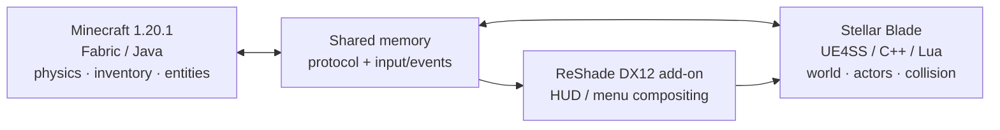

<div align="center">

# StellarCraft

### Minecraft gameplay, inside the world of Stellar Blade.

**Keep Stellar Blade's world. Play by Minecraft's rules.**

> 🤖 **Created by OpenAI Codex.** StellarCraft is an AI-created project developed with Codex, with its goals, direction, and in-game testing guided by the project maintainer.

[](https://github.com/Slime11123/StellarCraft)
[](https://www.minecraft.net/)
[](https://fabricmc.net/)
[](https://github.com/Slime11123/StellarCraft)
[](LICENSE)

**English** · [简体中文](README.zh-CN.md)

[Features](#features) · [Screenshots](#screenshots) · [Requirements](#requirements) · [Installation](#installation--developer-setup) · [Roadmap](#roadmap) · [Building](#building-from-source)

</div>

---

## What is StellarCraft?

**StellarCraft** is an experimental integration that brings Minecraft's player systems into **Stellar Blade** on PC. Switch between Eve and Minecraft-style control, use a Minecraft inventory and HUD, move with Minecraft-inspired rules, and interact with blocks and selected entities within Stellar Blade's world.

Neither game is replaced or recreated. A **Minecraft Fabric mod**, a **Stellar Blade-side UE4SS/C++ integration**, and a **ReShade DirectX 12 add-on** coordinate through a shared-memory protocol. Minecraft supplies gameplay state; Stellar Blade remains the world and presentation environment.

> [!IMPORTANT]
> **Early alpha / research project.** A local **v0.1.0-alpha.2 installer candidate** is packaged and has passed simulated-folder installation and restore checks, but it is **not yet a verified public Release or validated on another clean PC**. It still requires separately installed games and third-party runtimes. Back up your saves. StellarCraft is unofficial and not affiliated with SHIFT UP, Sony, Mojang or Microsoft.

## Screenshots

### Gameplay preview — Great Desert

<div align="center">
<a href="docs/images/2026-10-12-tnt-shield-gameplay.jpg">
  
</a>
<br />
<sub><strong>TNT visual effect & Minecraft HUD</strong> — in-game capture, October 12, 2026. The shield is visible; this frame alone does not demonstrate successful shield blocking or TNT damage to Stellar Blade enemies.</sub>
</div>

### Minecraft inventory inside Stellar Blade

<div align="center">
<a href="docs/images/2026-10-12-creative-inventory.jpg">
  
</a>
<br />
<sub><strong>Creative inventory, item categories and hotbar</strong> — captured in the running game on October 12, 2026.</sub>
</div>

<details>
<summary>Earlier rendering verification screenshots (October 9)</summary>

| Minecraft HUD compositing | Native hand rendering experiment |
|:---:|:---:|
|  |  |

</details>

<sub>These images document local development builds, not a packaged release. Visual effects shown in screenshots are not proof of every related gameplay/damage feature.</sub>

## Features

Feature notes updated through **October 15, 2026**. Past in-game demonstrations are noted separately from offline checks; offline regression is not in-game acceptance.

| System | Status | Current scope |
|---|---|---|
| Eve / Minecraft mode switching | ✅ Tested | **F4** switches control between Eve and the Minecraft player in tested ordinary areas. |
| Minecraft movement & building | ✅ Tested | Walking, jumping, crouching, creative flight, stairs and registered block placement/persistence. |
| Minecraft UI & inventory | ✅ Tested | Interactive creative inventory, item categories, hotbar and mouse input composited in-process via DX12; see the screenshots above. |
| Native visuals & items | ✅ Tested in selected scenes | Pixel-style geometry, some entity models, torch/glowstone light and Ender Pearl teleportation. |
| TNT visual effects | ✅ Tested visually | Pixelated explosion particles are visible in Stellar Blade; effects on registered MC blocks/entities were tested. |
| Ordinary Stellar Blade enemy combat | ✅ Tested in part | Native enemy registration and actual HP reduction/death recorded in the Great Desert. Not every weapon, arrow or TNT damage path has been individually attributed and verified. |
| Incoming damage & Eve protection | ✅ Tested in ordinary combat | Recent tests recorded 66 incoming-hit events; Minecraft survival HP changed while Eve's logged HP remained protected during the active lease. |
| Minecraft shield blocking | 🧪 Partially verified | Shield input and incoming-damage rules have been improved. Consistent direction-based blocking still requires new in-game validation. |
| Native shield-first damage | 🧪 Offline verified | MC hits now route to native Shield before HP, with tier-based live MaxShield scaling. Enemy/Boss damage and animations still await in-game acceptance. |
| Vanilla mob AI and cross-faction aggro | 🛠 Prerequisites | Original NoAI provenance recorded and checked via NBT; full vanilla navigation, native combat proxy and aggro are NOT enabled yet. |
| Repeated-hit native stagger / Groggy | 📋 Planned | Investigating original mechanics; no proven trigger or production implementation yet. |
| Bow, arrows & advanced combat | 🧪 Partially implemented | Code and offline regression tests exist; projectile visuals, arrow hits and TNT damage to real enemies still need combined in-game acceptance. |
| Elytra flight | 🧪 Partially tested | The maintainer confirmed basic Elytra flight and a visual improvement; dive, fireworks, durability and edge cases remain to be checked. |
| Mob/hand/character visuals | 🧪 Partially tested | Texture and knockback fixes were locally accepted; some visual animation and model-switching cases still require validation. |
| Stability & compatibility | 🧪 Partial | The maintainer reported a previously reproducible map-switch crash no longer occurred in one retest. Recent EVE performance changes and other map/exit paths still need validation. |

**Evidence:** [Current status](CURRENT_STATE.md) · [Shield-first damage](docs/PLAN_MC_NATIVE_SHIELD_FIRST_DAMAGE_2026-10-14.md) · [Stagger investigation](docs/PLAN_MC_COMBO_NATIVE_STAGGER_2026-10-15.md) · [Native combat](docs/PLAN_NATIVE_COMBAT_2026-10-12.md).

**Scope note:** Screenshots document rendering and UI, not automatically successful shield blocks or native TNT damage. Performance numbers and acceptance tests are scene-specific.

## Requirements

| Component | Development environment / notes |
|---|---|
| Operating system | Windows, x64 |
| Stellar Blade | PC version; launch and test through your own legitimate installation |
| Minecraft | **Java Edition 1.20.1** |
| Mod loader | **Fabric Loader 0.19.5** |
| Fabric API | **0.92.2+1.20.1** |
| Java | **Java 21** runtime; JDK 21 for source development |
| Graphics integration | DirectX 12; compatible **ReShade add-on runtime** (tested with 6.8.0) |
| Native integration | Compatible UE4SS setup; locally generated SDK headers may be needed for a full native build |
| C++ development | Visual Studio 2022 C++ tools; xmake for the native project |

> [!CAUTION]
> Native game hooks and injected add-ons can conflict with game updates, anti-cheat software or other mods, and may violate applicable terms. Use at your own risk; do not test with irreplaceable saves. No game executables, proprietary game assets or extracted Stellar Blade SDK headers are distributed here.

## Installation / Developer Setup

### Alpha 2 package status

A **v0.1.0-alpha.2 Windows x64 installer ZIP** has been built **locally**. It is NOT YET a verified public release. Once independently tested and published, packages will be listed on the [GitHub Releases page](https://github.com/Slime11123/StellarCraft/releases). GitHub auto-generated source-code ZIP files are not installers.

The local candidate contains a Fabric JAR, native shared-memory DLL, ReShade DX12 add-on, five Lua modules, shader and configuration, an installer with SHA-256 checking, and a backup restoration script. **It does not include** either game, game assets, the extracted SDK, Java, Fabric API, UE4SS, or a ReShade runtime.

**Prerequisites:** Windows x64; legitimately owned Stellar Blade PC and Minecraft Java 1.20.1; Fabric Loader 0.19.5 and a compatible Fabric API for 1.20.1; Java 21; separately installed compatible [UE4SS](https://github.com/UE4SS-RE/RE-UE4SS) and a full [ReShade add-on runtime](https://reshade.me/). Back up both games and close them before installation.

**When a verified ZIP becomes available:** extract it, read the included Chinese/English installation guide, run Install.cmd and select the Stellar Blade SB/Binaries/Win64 folder and Minecraft Fabric mods folder. The installer checks payload hashes, adjusts Lua to the selected location, copies only StellarCraft-owned components and backs up overwritten files. Restore-Backup.cmd can restore the recorded backup if installed files have not been subsequently modified.

The **Alpha 2 prototype** passed ZIP integrity, payload hashes, and simulated-folder install/configuration/path/restore tests only. **No clean-machine real-game acceptance or full clean-checkout JAR build** has been completed; this is not a stable, dependency-free one-click installer.

### Developer source setup

For development, clone the source and submodules:

    git clone --recurse-submodules https://github.com/Slime11123/StellarCraft.git
    cd StellarCraft

Follow [the build instructions below](#building-from-source) and the [ReShade integration guide](sb-mod/reshade-addon/README.md). Some local builds use a previous base JAR, mapping caches and local UE4SS configuration, so a clean-machine build is not guaranteed. Start a matching Minecraft Fabric instance and Stellar Blade via Steam; press F4 to switch. See [current state](CURRENT_STATE.md) and [issues](https://github.com/Slime11123/StellarCraft/issues).

## Controls

| Key | Function |
|---|---|
| **F4** | Switch between Eve mode and Minecraft mode |
| **E** | Open/close Minecraft inventory while in Minecraft mode |
| **Esc** | Back out of Minecraft screens / context-dependent menu control |
| **Shift** | Minecraft crouch while controlling the Minecraft player |
| **F5** | Minecraft camera perspective control (behavior may vary by current integration) |
| Minecraft movement keys | Standard configured Minecraft controls in Minecraft mode |

## How it works



The game-facing renderer uses native Stellar Blade geometry where implemented, while the ReShade add-on composites Minecraft UI inside the game's DirectX 12 frame. This is an **in-process** approach; the older external transparent-window overlay is no longer the active architecture.

Read [the technical design](docs/DESIGN.md) for coordinate mapping, entity bridging, collisions, rendering and authority rules.

## Building from source

**Minecraft Fabric mod** (Windows PowerShell, JDK 21):

```powershell
cd mc-mod
.\gradlew.bat build
```

> A complete clean-machine Gradle build has not been consistently verified in the recorded Windows environment. Some local development builds used an incremental/remapping script. Do not assume the above command succeeds on every system yet.

**ReShade DirectX 12 add-on** (Visual Studio 2022 C++ toolchain):

```powershell
cd sb-mod\reshade-addon
.\build.bat
```

**Stellar Blade-side native project** (xmake and VS 2022; development scaffold):

```powershell
cd sb-mod
xmake f -m release
xmake
```

The native xmake target has an optional SDK-dependent configuration. **The generated Stellar Blade SDK is intentionally not part of this repository**; a successful SDK-free scaffold build does not imply full gameplay integration. Refer to [sb-mod/xmake.lua](sb-mod/xmake.lua).

## Repository layout

| Directory | Purpose |
|---|---|
| [`mc-mod/`](mc-mod/) | Minecraft Fabric Java mod, JNI bridge, rendering/movement hooks and tests |
| [`sb-mod/`](sb-mod/) | Stellar Blade-side C++ and Lua, ReShade add-on, native tests |
| [`protocol/`](protocol/) | Shared-memory layout and cross-process protocol |
| [`docs/`](docs/) | Design, repair plans and test/verification notes |
| [`tools/`](tools/) | Developer utilities, probes and regression tests |
| `stellarcraft-mcmod-forge-源码交付包/` | Experimental Forge migration source snapshot; **not** the maintained primary runtime |

## Roadmap

- [x] Demonstrate shared-memory protocol, DX12 UI, Eve/Minecraft switching, inventory and selected world features
- [x] Verify basic movement, Elytra flight, ordinary native enemy HP interaction and selected survival damage cases
- [x] Prepare a local **v0.1.0-alpha.2** installation candidate with hash verification and simulated-folder install/restore tests
- [x] Implement native shield-first damage and live MaxShield scaling with offline checks
- [x] Preserve original NoAI provenance for vanilla mob AI work with offline NBT validation
- [ ] Verify Shield-first behavior with real ordinary enemies/Bosses and shield phase transitions in game
- [ ] Authenticate native mob proxies and implement vanilla navigation, AI and cross-faction combat
- [ ] Investigate and implement real native multi-hit stagger/Groggy without additional damage
- [ ] Finish acceptance of hit reactions, arrow/TNT paths, advanced flight and map/exit stability
- [ ] Reproduce full builds from a clean checkout and verify an installer on another clean PC
- [ ] Publish a documented GitHub **pre-release** after real-game acceptance

See [current progress](CURRENT_STATE.md), [shield-first plan](docs/PLAN_MC_NATIVE_SHIELD_FIRST_DAMAGE_2026-10-14.md) and [stagger study](docs/PLAN_MC_COMBO_NATIVE_STAGGER_2026-10-15.md).

## Known limitations

- Alpha 2 is a **local installer candidate**, not a public, independently tested stable version. Games and third-party dependencies must be installed separately.
- Shield-first damage and NoAI provenance pass offline checks, not full real-game Boss/shield validation or vanilla mob AI/aggro acceptance.
- Authentic native repeated-hit stagger remains at the research and design stage.
- A past map-switch crash was reported improved in one retest, but newer EVE performance work and broader transitions/exits still need acceptance.
- Bow/arrow, TNT-to-native-enemy, heavy-hit visuals, advanced Elytra, boat physics and animations are not fully verified.
- Some native SDK-dependent builds require separately obtained lawful dependencies. No multiplayer support is claimed.

## Contributing & Credits

Bug reports and pull requests are welcome once the repository is public. Please include reproducible steps, versions and logs **after removing personal paths, tokens and save data**.

StellarCraft takes architectural inspiration from [SkyCraft](https://github.com/chasmlol/SkyCraft), but is an independent project for Stellar Blade. Thanks to the maintainers of Minecraft Fabric, UE4SS, ReShade, [MinHook](https://github.com/TsudaKageyu/minhook) and other upstream tools.

## License

See [Third-party notices](THIRD-PARTY-NOTICES.md) for upstream copyright and license terms.

Project-authored code is provided under the [MIT License](LICENSE), subject to any applicable third-party notices and licenses. External tools, libraries, games, artwork and assets remain the property of their respective owners; the project's MIT license does **not** override their terms.
