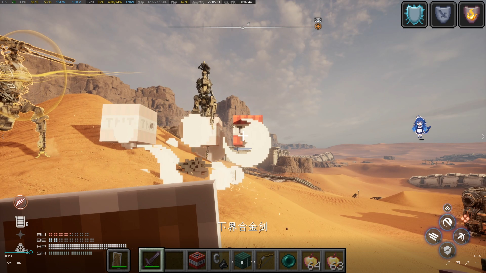
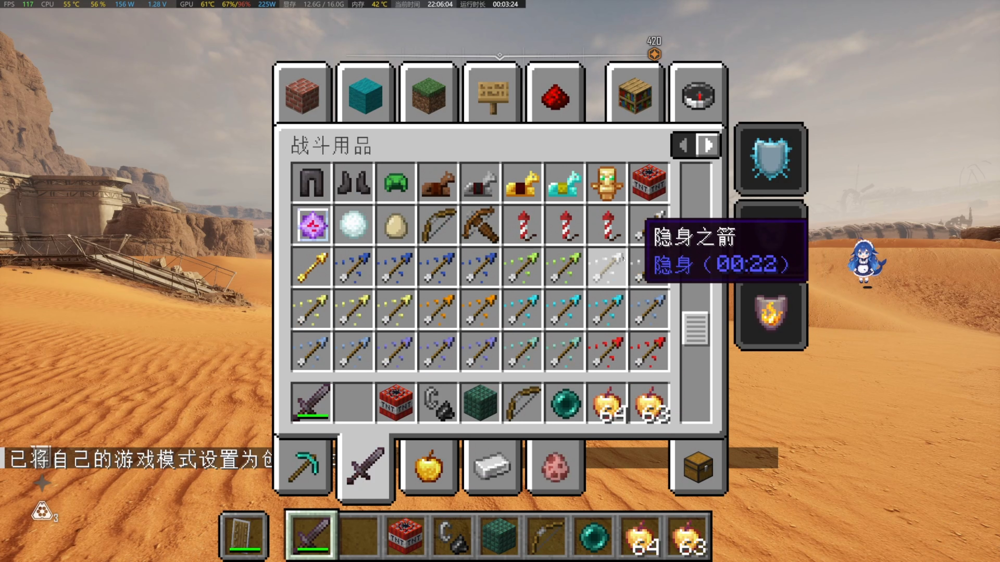
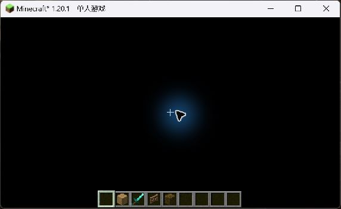
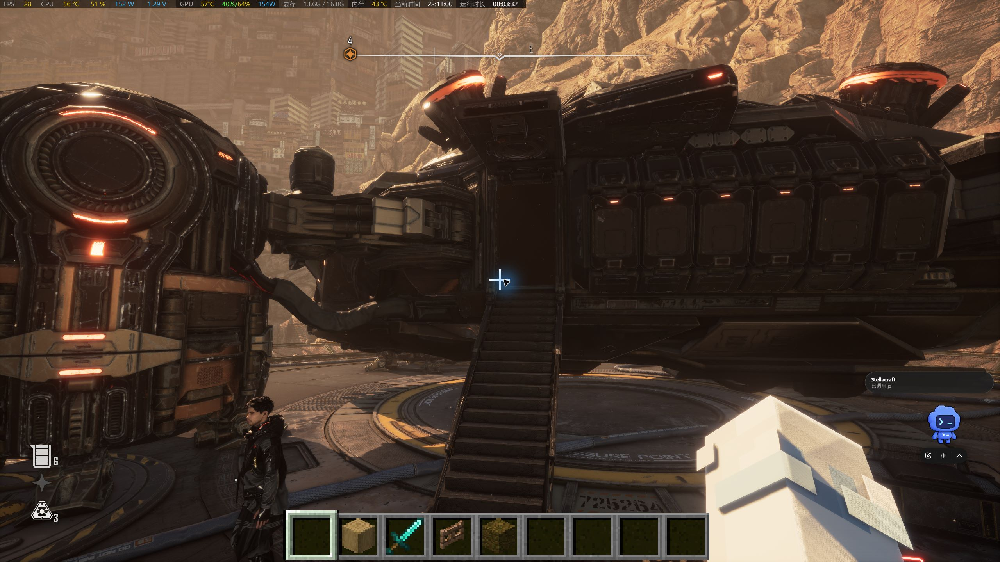
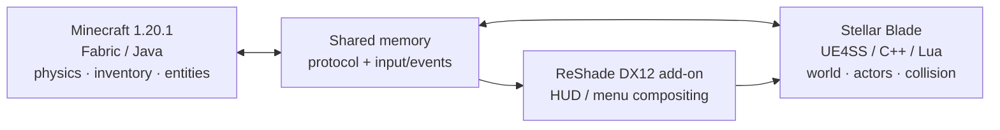

<div align="center">

# StellarCraft

### Minecraft gameplay, inside the world of Stellar Blade.

**Keep Stellar Blade's world. Play by Minecraft's rules.**

> 🤖 **Created by OpenAI Codex.** StellarCraft is an AI-created project developed with Codex, with its goals, direction, and in-game testing guided by the project maintainer.

[](https://github.com/Slime11123/StellarCraft)
[](https://www.minecraft.net/)
[](https://fabricmc.net/)
[](https://github.com/Slime11123/StellarCraft)
[](LICENSE)

**English** · [简体中文](README.zh-CN.md)

[Features](#features) · [Screenshots](#screenshots) · [Requirements](#requirements) · [Installation](#installation--developer-setup) · [Roadmap](#roadmap) · [Building](#building-from-source)

</div>

---

## What is StellarCraft?

**StellarCraft** is an experimental integration that brings Minecraft's player systems into **Stellar Blade** on PC. Switch between Eve and Minecraft-style control, use a Minecraft inventory and HUD, move with Minecraft-inspired rules, and interact with blocks and selected entities within Stellar Blade's world.

Neither game is replaced or recreated. A **Minecraft Fabric mod**, a **Stellar Blade-side UE4SS/C++ integration**, and a **ReShade DirectX 12 add-on** coordinate through a shared-memory protocol. Minecraft supplies gameplay state; Stellar Blade remains the world and presentation environment.

> [!IMPORTANT]
> **Early alpha / research project — not a plug-and-play release.** Features described below have different validation levels, and there is currently no packaged public installer. Back up game saves before testing. This project is not affiliated with SHIFT UP, Sony, Mojang or Microsoft, and users must own their games.

## Screenshots

### Gameplay preview — Great Desert

<div align="center">
<a href="docs/images/2026-10-12-tnt-shield-gameplay.jpg">
  
</a>
<br />
<sub><strong>TNT visual effect & Minecraft HUD</strong> — in-game capture, October 12, 2026. The shield is visible; this frame alone does not demonstrate successful shield blocking or TNT damage to Stellar Blade enemies.</sub>
</div>

### Minecraft inventory inside Stellar Blade

<div align="center">
<a href="docs/images/2026-10-12-creative-inventory.jpg">
  
</a>
<br />
<sub><strong>Creative inventory, item categories and hotbar</strong> — captured in the running game on October 12, 2026.</sub>
</div>

<details>
<summary>Earlier rendering verification screenshots (October 9)</summary>

| Minecraft HUD compositing | Native hand rendering experiment |
|:---:|:---:|
|  |  |

</details>

<sub>These images document local development builds, not a packaged release. Visual effects shown in screenshots are not proof of every related gameplay/damage feature.</sub>

## Features

The following statuses are based on project logs and owner-led in-game testing through **October 12, 2026**. “Tested” refers only to the stated scenario.

| System | Status | Current scope |
|---|---|---|
| Eve / Minecraft mode switching | ✅ Tested | **F4** switches control between Eve and the Minecraft player in tested ordinary areas. |
| Minecraft movement & building | ✅ Tested | Walking, jumping, crouching, creative flight, stairs and registered block placement/persistence. |
| Minecraft UI & inventory | ✅ Tested | Interactive creative inventory, item categories, hotbar and mouse input composited in-process via DX12; see the screenshots above. |
| Native visuals & items | ✅ Tested in selected scenes | Pixel-style geometry, some entity models, torch/glowstone light and Ender Pearl teleportation. |
| TNT visual effects | ✅ Tested visually | Pixelated explosion particles are visible in Stellar Blade; effects on registered MC blocks/entities were tested. |
| Ordinary Stellar Blade enemy combat | ✅ Tested in part | Native enemy registration and actual HP reduction/death recorded in the Great Desert. Not every weapon, arrow or TNT damage path has been individually attributed and verified. |
| Incoming damage & Eve protection | ✅ Tested in ordinary combat | Recent tests recorded 66 incoming-hit events; Minecraft survival HP changed while Eve's logged HP remained protected during the active lease. |
| Minecraft shield blocking | 🛠 In progress | Shield can be raised, but a live test still lost HP because verified hit direction was missing; a source-direction fix awaits another in-game test. |
| Bow, arrows & advanced combat | 🧪 Partially implemented | Code and offline regression tests exist; projectile visuals, arrow hits and TNT damage to real enemies still need combined in-game acceptance. |
| Elytra flight | 🧪 Partially tested | The maintainer confirmed basic Elytra flight and a visual improvement; dive, fireworks, durability and edge cases remain to be checked. |
| Mob/hand/character visuals | 🧪 Partially tested | Texture and knockback fixes were locally accepted; some visual animation and model-switching cases still require validation. |
| Stability & compatibility | 🛠 In progress | An ActorProxy renderer-null crash was identified and a fix built, but restart verification is pending. Map-transition and game-exit crashes are not confirmed fixed. |

**Evidence:** [Current status](CURRENT_STATE.md) · [Native combat progress](docs/PLAN_NATIVE_COMBAT_2026-10-12.md) · [Visual/combat worklist](docs/PLAN_VISUAL_COMBAT_2026-10-12.md).

**Scope note:** Screenshots document rendering and UI, not automatically successful shield blocks or native TNT damage. Performance numbers and acceptance tests are scene-specific.

## Requirements

| Component | Development environment / notes |
|---|---|
| Operating system | Windows, x64 |
| Stellar Blade | PC version; launch and test through your own legitimate installation |
| Minecraft | **Java Edition 1.20.1** |
| Mod loader | **Fabric Loader 0.19.5** |
| Fabric API | **0.92.2+1.20.1** |
| Java | **JDK 21** for current source/build configuration |
| Graphics integration | DirectX 12; compatible **ReShade add-on runtime** (tested with 6.8.0) |
| Native integration | Compatible UE4SS setup; locally generated SDK headers may be needed for a full native build |
| C++ development | Visual Studio 2022 C++ tools; xmake for the native project |

> [!CAUTION]
> Native game hooks and injected add-ons can conflict with game updates, anti-cheat software or other mods, and may violate applicable terms. Use at your own risk; do not test with irreplaceable saves. No game executables, proprietary game assets or extracted Stellar Blade SDK headers are distributed here.

## Installation / Developer Setup

**There is no public one-click package yet.** These are development-oriented steps, not a guarantee of a working installation on a clean PC.

1. **Back up** Stellar Blade saves and your Minecraft worlds. Keep the original game files available for restoration.
2. Install **Minecraft Java 1.20.1**, **Fabric Loader 0.19.5**, **Fabric API 0.92.2+1.20.1**, and **Java 21**.
3. Clone this repository, including MinHook:

   ```powershell
   git clone --recurse-submodules https://github.com/Slime11123/StellarCraft.git
   cd StellarCraft
   ```

4. Build the Fabric mod and the ReShade add-on using the instructions below. Native integration requires a compatible locally configured UE4SS environment.
5. Follow [the ReShade add-on deployment and verification notes](sb-mod/reshade-addon/README.md) to configure the compatible ReShade **add-on** runtime, shader and mod components. Paths in that document are examples from a developer machine, **not** universal install locations.
6. On a properly configured development setup, start the Minecraft instance and launch Stellar Blade through Steam. Use **F4** to change modes.

If a build or launch step fails, consult the [current project state](CURRENT_STATE.md), [design document](docs/DESIGN.md), and [issue tracker](https://github.com/Slime11123/StellarCraft/issues). The project does not yet provide fully reproducible end-user packaging.

## Controls

| Key | Function |
|---|---|
| **F4** | Switch between Eve mode and Minecraft mode |
| **E** | Open/close Minecraft inventory while in Minecraft mode |
| **Esc** | Back out of Minecraft screens / context-dependent menu control |
| **Shift** | Minecraft crouch while controlling the Minecraft player |
| **F5** | Minecraft camera perspective control (behavior may vary by current integration) |
| Minecraft movement keys | Standard configured Minecraft controls in Minecraft mode |

## How it works



The game-facing renderer uses native Stellar Blade geometry where implemented, while the ReShade add-on composites Minecraft UI inside the game's DirectX 12 frame. This is an **in-process** approach; the older external transparent-window overlay is no longer the active architecture.

Read [the technical design](docs/DESIGN.md) for coordinate mapping, entity bridging, collisions, rendering and authority rules.

## Building from source

**Minecraft Fabric mod** (Windows PowerShell, JDK 21):

```powershell
cd mc-mod
.\gradlew.bat build
```

> A complete clean-machine Gradle build has not been consistently verified in the recorded Windows environment. Some local development builds used an incremental/remapping script. Do not assume the above command succeeds on every system yet.

**ReShade DirectX 12 add-on** (Visual Studio 2022 C++ toolchain):

```powershell
cd sb-mod\reshade-addon
.\build.bat
```

**Stellar Blade-side native project** (xmake and VS 2022; development scaffold):

```powershell
cd sb-mod
xmake f -m release
xmake
```

The native xmake target has an optional SDK-dependent configuration. **The generated Stellar Blade SDK is intentionally not part of this repository**; a successful SDK-free scaffold build does not imply full gameplay integration. Refer to [sb-mod/xmake.lua](sb-mod/xmake.lua).

## Repository layout

| Directory | Purpose |
|---|---|
| [`mc-mod/`](mc-mod/) | Minecraft Fabric Java mod, JNI bridge, rendering/movement hooks and tests |
| [`sb-mod/`](sb-mod/) | Stellar Blade-side C++ and Lua, ReShade add-on, native tests |
| [`protocol/`](protocol/) | Shared-memory layout and cross-process protocol |
| [`docs/`](docs/) | Design, repair plans and test/verification notes |
| [`tools/`](tools/) | Developer utilities, probes and regression tests |
| `stellarcraft-mcmod-forge-源码交付包/` | Experimental Forge migration source snapshot; **not** the maintained primary runtime |

## Roadmap

- [x] Establish shared-memory protocol and in-process DX12 UI compositing
- [x] Demonstrate Eve/Minecraft switching, interactive creative inventory and registered block placement
- [x] Demonstrate native-rendered entities, lighting, pearls and visible TNT particles in selected scenes
- [x] Verify ordinary enemy registration, real native HP reduction and survival-mode incoming damage with Eve protection
- [x] Demonstrate basic Elytra flight (some behaviors still unverified)
- [ ] Verify shield-facing/blocked damage and the new hit-source-direction fix in-game
- [ ] Re-test the ActorProxy renderer fix after restart; validate arrows, bow visuals and enemy TNT damage
- [ ] Address outstanding model/hand animation edge cases and extend mob behavior
- [ ] Resolve remaining map-transition and exit crashes; complete regression coverage
- [ ] Verify Elytra dive/fireworks/durability and expand entity/physics parity
- [ ] Provide reproducible clean builds, packaged installer and public Releases

Latest progress: [CURRENT_STATE.md](CURRENT_STATE.md) · [Native combat work](docs/PLAN_NATIVE_COMBAT_2026-10-12.md) · [Visual combat validation](docs/PLAN_VISUAL_COMBAT_2026-10-12.md).

## Known limitations

- Not ready for general end-user installation; expected bugs and incomplete features.
- Some game map transitions and exit paths remain unstable; a Minecraft ActorProxy renderer-null crash has a code fix pending in-game restart verification.
- Shield direction/blocking, native-enemy TNT damage and several bow/arrow scenarios remain unverified or incomplete.
- Basic Elytra flight has been demonstrated, but advanced flying mechanics and durability scenarios are not fully accepted.
- Full vanilla mob AI, boats on water and some character/hand animation cases are not yet supported or fully verified.
- Native texture/material behavior may differ between Stellar Blade areas.
- Native builds requiring generated Stellar Blade SDK headers need separately obtained, lawfully usable dependencies.
- No multiplayer support is claimed.

## Contributing & Credits

Bug reports and pull requests are welcome once the repository is public. Please include reproducible steps, versions and logs **after removing personal paths, tokens and save data**.

StellarCraft takes architectural inspiration from [SkyCraft](https://github.com/chasmlol/SkyCraft), but is an independent project for Stellar Blade. Thanks to the maintainers of Minecraft Fabric, UE4SS, ReShade, [MinHook](https://github.com/TsudaKageyu/minhook) and other upstream tools.

## License

Project-authored code is provided under the [MIT License](LICENSE), subject to any applicable third-party notices and licenses. External tools, libraries, games, artwork and assets remain the property of their respective owners; the project's MIT license does **not** override their terms.
