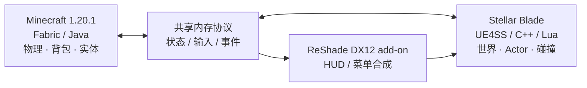

<div align="center">

# StellarCraft

### 在《剑星》的世界里，体验 Minecraft 的玩法。

**保留剑星的世界，用 Minecraft 的规则游玩。**

> 🤖 **本项目由 OpenAI Codex 创建。** StellarCraft 是由 Codex 参与代码编写和持续迭代的实验性项目，开发目标、项目方向与游戏实测由项目维护者指导和验证。

[](https://github.com/Slime11123/StellarCraft)
[](https://www.minecraft.net/)
[](https://fabricmc.net/)
[](https://github.com/Slime11123/StellarCraft)
[](LICENSE)

[English](README.md) · **简体中文**

[项目介绍](#项目介绍) · [游戏截图](#游戏截图) · [功能展示](#功能展示) · [安装说明](#安装说明开发者预览) · [开发路线图](#开发路线图) · [源码编译](#源码编译)

</div>

---

## 项目介绍

**StellarCraft** 是一个实验性的跨游戏 Mod 工程，尝试把 **Minecraft 的玩家系统**带入 PC 版《剑星》（Stellar Blade）。你可以在 Eve 模式和 Minecraft 控制模式之间切换，在剑星的场景里使用 Minecraft 的背包、HUD、移动规则、方块和部分实体机制。

项目**没有重写两款游戏**：Minecraft Fabric Mod 负责 Minecraft 侧逻辑，剑星侧 UE4SS/C++ 与 Lua 负责游戏世界和原生对象，ReShade DX12 插件负责画面内的 Minecraft UI 合成。两个进程通过共享内存协议交换状态。

> [!IMPORTANT]
> **当前为 Early Alpha / 技术研究阶段，不是开箱即用的正式版本。** 不同功能有不同的实机验证程度，目前尚未发布通用安装包。测试前请备份存档。本项目与 SHIFT UP、Sony、Mojang、Microsoft 无官方关联；使用者需合法拥有相应游戏。

## 游戏截图

| 剑星画面内的 Minecraft HUD | 原生渲染实验截图 |
|:---:|:---:|
|  |  |

<sub>图片来自本地开发验证记录，和最新构建效果可能不同。后续将补充演示视频与更多截图。</sub>

## 功能展示

以下状态按 **2026 年 10 月 11 日** 的项目记录整理：

| 功能 | 状态 | 当前范围 |
|---|---|---|
| Eve / Minecraft 模式切换 | ✅ 已实测 | 使用 **F4** 往返切换控制模式。 |
| MC 移动与物理 | ✅ 已实测 | 行走、跳跃、蹲下、创造飞行和指定台阶/地形移动。 |
| MC HUD、背包及菜单 | ✅ 已实测 | 在剑星 DX12 画面内合成，可交互的背包和鼠标输入。 |
| MC 方块 | ✅ 已实测 | 注册方块的放置、像素几何、贴图和状态持久化。 |
| 火把、萤石与末影珍珠 | ✅ 已实测 | 指定场景中的原生灯光和安全落点传送。 |
| TNT | 🧪 部分完成 | 点燃、粒子及注册 MC 方块/实体交互已有实测；对剑星真实敌人的完整伤害链路仍需验证。 |
| MC 生物和船 | 🧪 部分完成 | 猪、橡木船在剑星显示；完整原版 AI、水面船物理尚未实现。 |
| 跨游戏受伤规则 | 🧪 部分完成 | 玩家伤害模式规则已在本地确认；其他战斗场景仍需验收。 |
| 角色、手部、材质和动画 | 🛠 修复中 | 仍存在贴图、同步、手部等待修复问题。 |
| 地图切换和稳定性 | 🛠 修复中 | MC 激活时部分地图切换以及退出路径存在崩溃风险。 |
| 鞘翅、高级投射物、完整生物行为 | 📋 规划中 | 尚不能宣称完整实现。 |

**说明：** 测试记录仅代表指定场景；不保证所有地图和机器都稳定运行。

## 运行环境

| 项目 | 当前开发环境 |
|---|---|
| 操作系统 | Windows x64 |
| 剑星 | PC 正版游戏，通过 Steam 启动测试 |
| Minecraft | **Java Edition 1.20.1** |
| Fabric Loader | **0.19.5** |
| Fabric API | **0.92.2+1.20.1** |
| Java | **JDK 21** |
| 图形集成 | DirectX 12、支持 add-on 的 ReShade（开发时验证过 6.8.0） |
| 原生 Mod | 兼容剑星的 UE4SS 环境；完整构建可能需要本地生成的 SDK |
| 编译工具 | Visual Studio 2022 C++、xmake |

> [!CAUTION]
> 原生 Hook、注入和插件可能与游戏更新或其他 Mod 冲突，也可能违反适用的服务条款。请自行评估风险并备份存档。本仓库不分发游戏本体、专有游戏资源或提取的剑星 SDK 头文件。

## 安装说明（开发者预览）

**目前没有可一键安装的正式 Release。** 以下仅是开发环境搭建概要，不保证在全新电脑上直接成功。

1. 备份《剑星》存档和 Minecraft 世界，保留可恢复的原始游戏文件。
2. 准备 Minecraft **1.20.1**、Fabric Loader **0.19.5**、Fabric API **0.92.2+1.20.1**、**Java 21**。
3. 克隆工程和 MinHook 子模块：

   ```powershell
   git clone --recurse-submodules https://github.com/Slime11123/StellarCraft.git
   cd StellarCraft
   ```

4. 根据下方说明构建 Fabric Mod、ReShade 插件。完整原生游戏集成还需要匹配的 UE4SS 本地环境。
5. 按 [ReShade 插件文档](sb-mod/reshade-addon/README.md) 配置支持 add-on 的运行库、着色器和组件。文档内出现的本机绝对路径只属于原开发环境，并非通用安装路径。
6. 开发环境正确配置后，启动 Minecraft 对应实例，再通过 Steam 启动《剑星》。按 **F4** 切换模式。

如果无法编译或启动，请查看 [当前项目状态](CURRENT_STATE.md)、[架构设计](docs/DESIGN.md) 和 [Issues](https://github.com/Slime11123/StellarCraft/issues)。目前还没有经过完整验证的普通用户自动安装流程。

## 操作按键

| 按键 | 作用 |
|---|---|
| **F4** | Eve / Minecraft 模式切换 |
| **E** | MC 模式下打开或关闭背包 |
| **Esc** | 返回 MC 菜单上一级／依具体模式处理 |
| **Shift** | MC 模式下蹲下 |
| **F5** | Minecraft 视角切换（取决于当前集成状态） |
| MC 默认移动按键 | MC 模式使用配置的 Minecraft 按键 |

## 技术架构



已实现的世界几何通过剑星原生对象渲染，Minecraft UI 则使用 ReShade DX12 插件在游戏进程内合成。旧的外部透明 Overlay 窗口**已不再是当前架构**。

详见 [技术设计文档](docs/DESIGN.md)。

## 源码编译

**Minecraft Fabric Mod**（Windows PowerShell、JDK 21）：

```powershell
cd mc-mod
.\gradlew.bat build
```

> 项目记录中，Windows 上的完整 Gradle 构建仍有环境相关问题，部分开发版本采用增量编译与 remap 脚本。以上命令不保证在任意新环境直接成功。

**ReShade DX12 插件**（VS 2022 C++ 工具链）：

```powershell
cd sb-mod\reshade-addon
.\build.bat
```

**剑星侧 C++ 工程**（xmake、VS 2022）：

```powershell
cd sb-mod
xmake f -m release
xmake
```

xmake 工程有可选的 SDK 配置。**仓库不包含提取的剑星 SDK**，无 SDK 时编译的框架产物也不代表已经具备完整游戏功能。参见 [sb-mod/xmake.lua](sb-mod/xmake.lua)。

## 工程结构

| 目录 | 作用 |
|---|---|
| [`mc-mod/`](mc-mod/) | Fabric Java 代码、JNI、移动/渲染及相关测试 |
| [`sb-mod/`](sb-mod/) | 剑星侧 C++/Lua、ReShade 插件、原生测试 |
| [`protocol/`](protocol/) | 跨进程共享内存协议 |
| [`docs/`](docs/) | 设计、修复方案与验证记录 |
| [`tools/`](tools/) | 调试工具、探针和回归测试 |
| `stellarcraft-mcmod-forge-源码交付包/` | 实验性 Forge 迁移源码快照，非当前主要运行版本 |

## 开发路线图

- [x] 建立共享内存通信、进程内 DX12 UI 合成
- [x] 验证 Eve / Minecraft 切换、背包以及注册方块放置
- [x] 验证部分原生实体、照明、珍珠与 TNT 粒子
- [ ] 修复人物、生物、手部材质和移动动画
- [ ] 完善击退、弓箭显示及跨游戏战斗验证
- [ ] 修复地图切换与退出崩溃，完善世界清理
- [ ] 扩展生物行为、碰撞与物理效果
- [ ] 开发并验收鞘翅功能
- [ ] 实现可重复编译、安装打包和正式 Releases

最新进度：[CURRENT_STATE.md](CURRENT_STATE.md) · [原生世界修复记录](docs/REPAIR_2026-10-11_NATIVE_WORLD.md)。

## 已知限制

- 尚不适合普通玩家无配置安装，功能不完整且可能遇到错误。
- 部分地图切换、模式渲染和退出路径尚未稳定。
- 完整 MC 生物 AI、水面船只物理、部分投射物、鞘翅尚不完整或未验收。
- 剑星不同地区的原生材质可能影响 Minecraft 模型显示。
- 需要剑星 SDK 的编译方案，必须自行依法获取相应依赖。
- 目前不宣称支持多人联机。

## 贡献与致谢

仓库公开后欢迎通过 Issues 和 Pull Requests 交流。提交日志前请清除私人路径、令牌及存档数据。

StellarCraft 的架构受 [SkyCraft](https://github.com/chasmlol/SkyCraft) 启发，但它是一个独立的《剑星》项目。感谢 Minecraft Fabric、UE4SS、ReShade、[MinHook](https://github.com/TsudaKageyu/minhook) 及相关开源工具的维护者。

## 开源协议

项目原创代码使用 [MIT License](LICENSE)，第三方组件遵循各自的许可证。其他游戏、软件、素材和资产仍归原权利人所有；项目 MIT 许可证不覆盖第三方内容的权利与限制。
