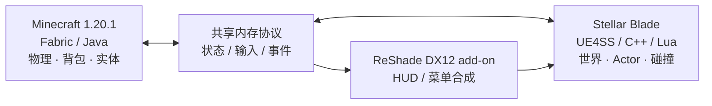

<div align="center">

# StellarCraft

### 在《剑星》的世界里，体验 Minecraft 的玩法。

**保留剑星的世界，用 Minecraft 的规则游玩。**

> 🤖 **本项目由 OpenAI Codex 创建。** StellarCraft 是由 Codex 参与代码编写和持续迭代的实验性项目，开发目标、项目方向与游戏实测由项目维护者指导和验证。

[](https://github.com/Slime11123/StellarCraft)
[](https://www.minecraft.net/)
[](https://fabricmc.net/)
[](https://github.com/Slime11123/StellarCraft)
[](LICENSE)

[English](README.md) · **简体中文**

[项目介绍](#项目介绍) · [游戏截图](#游戏截图) · [功能展示](#功能展示) · [安装说明](#安装说明开发者预览) · [开发路线图](#开发路线图) · [源码编译](#源码编译)

</div>

---

## 项目介绍

**StellarCraft** 是一个实验性的跨游戏 Mod 工程，尝试把 **Minecraft 的玩家系统**带入 PC 版《剑星》（Stellar Blade）。你可以在 Eve 模式和 Minecraft 控制模式之间切换，在剑星的场景里使用 Minecraft 的背包、HUD、移动规则、方块和部分实体机制。

项目**没有重写两款游戏**：Minecraft Fabric Mod 负责 Minecraft 侧逻辑，剑星侧 UE4SS/C++ 与 Lua 负责游戏世界和原生对象，ReShade DX12 插件负责画面内的 Minecraft UI 合成。两个进程通过共享内存协议交换状态。

> [!IMPORTANT]
> **当前为 Early Alpha / 技术研究阶段。** 已在本地制作 **v0.1.0-alpha.2 安装包候选版**，并通过模拟目录安装和恢复测试，但**尚未发布为经过验证的公开 Release，也没有通过全新电脑的实机安装验收**。玩家仍需自行准备游戏及第三方依赖。测试前请备份存档，本项目与 SHIFT UP、Sony、Mojang、Microsoft 无官方关联。

## 游戏截图

### 实机展示 · 大沙漠

<div align="center">
<a href="docs/images/2026-10-12-tnt-shield-gameplay.jpg">
  
</a>
<br />
<sub><strong>TNT 爆炸视觉效果与 Minecraft HUD</strong> —— 2026 年 10 月 12 日实机截图。画面中可见盾牌，但不能据此证明已成功格挡或 TNT 已对剑星敌人造成伤害。</sub>
</div>

### 在《剑星》中打开 Minecraft 创造模式背包

<div align="center">
<a href="docs/images/2026-10-12-creative-inventory.jpg">
  
</a>
<br />
<sub><strong>创造模式背包、物品分类和快捷栏</strong> —— 2026 年 10 月 12 日实际游戏画面。</sub>
</div>

<details>
<summary>展开查看 10 月 9 日的早期渲染验证截图</summary>

| Minecraft HUD 合成 | 原生手部渲染实验 |
|:---:|:---:|
|  |  |

</details>

<sub>图片来自本地开发构建，不代表已经发布可安装成品。视觉效果截图与完整伤害、格挡验收应分别看待。</sub>

## 功能展示

功能状态依据截至 **2026 年 10 月 15 日** 的开发记录整理。历史实机展示与离线测试分别说明；离线回归通过不等于游戏内验收。

| 功能 | 状态 | 当前范围 |
|---|---|---|
| Eve / Minecraft 模式切换 | ✅ 已实测 | 普通区域使用 **F4** 往返切换控制权。 |
| Minecraft 移动与建造 | ✅ 已实测 | 行走、跳跃、蹲下、创造飞行、台阶移动、登记方块放置与状态持久化。 |
| MC HUD 与创造背包 | ✅ 已实测 | 剑星 DX12 游戏画面内可交互的创造背包、分类、快捷栏和鼠标输入，见上方实机截图。 |
| 原生像素模型与物品 | ✅ 指定场景实测 | 部分实体模型、火把/萤石照明和末影珍珠安全传送。 |
| TNT 爆炸视觉效果 | ✅ 已实测显示 | 剑星画面中可见像素爆炸粒子；对登记的 MC 方块、实体的作用已有实测。 |
| 剑星普通敌人伤害 | ✅ 部分实测 | 大沙漠普通敌人登记、实际 HP 扣减乃至死亡已有日志证据；不能推断所有武器、箭矢和 TNT 来源都已单独验收。 |
| MC 生存受击与 Eve 保护 | ✅ 普通战斗实测 | 最新测试记录 66 次原生受击事件，MC 生存血量变化，保护租约有效期间 Eve 日志 HP 保持不变。 |
| Minecraft 盾牌格挡 | 🧪 部分验证 | 已改进举盾输入和生存受击规则，正确朝向格挡仍需实机重新验收。 |
| 剑星原生护盾优先结算 | 🧪 离线验证 | MC 命中先扣原生盾再扣 HP，实时 MaxShield 分档换算已通过离线检查；普通敌人/Boss 实机效果和动画仍待验收。 |
| 原版生物 AI 与跨阵营仇恨 | 🛠 前置阶段 | 已记录原始 NoAI 状态并通过 NBT 离线验证；完整原版寻路、原生战斗代理及双向仇恨尚未开启。 |
| 连击原生硬直 / Groggy | 📋 研究计划 | 仍在核对原版触发机制，尚无已认证的正式实现。 |
| 弓箭、投射物和伤害整合 | 🧪 部分实现 | 已有代码与离线回归，箭矢命中、投射物显示、TNT 对真实敌人伤害仍需联合实测。 |
| 鞘翅飞行 | 🧪 部分实测 | 用户已确认基础飞行与一次显示改善；俯冲、烟花、耐久等细节尚未全部验收。 |
| 生物、人物与手部效果 | 🧪 部分实测 | 贴图与击退修复已有用户验收；动画、模型切换等边界场景仍需检查。 |
| 稳定性与地图切换 | 🧪 部分实测 | 用户报告此前某个地图切换崩溃复测不再发生；后续 EVE 性能改动及其他切图、退出场景仍待验证。 |

**详细证据：** [最新状态](CURRENT_STATE.md) · [盾优先修复计划](docs/PLAN_MC_NATIVE_SHIELD_FIRST_DAMAGE_2026-10-14.md) · [连续攻击硬直计划](docs/PLAN_MC_COMBO_NATIVE_STAGGER_2026-10-15.md) · [原生战斗整合](docs/PLAN_NATIVE_COMBAT_2026-10-12.md)。

**说明：** 截图只证明当时的界面和视觉表现，不自动代表盾牌成功格挡或 TNT 已伤害剑星敌人；性能与功能实测均限于指定场景。

## 运行环境

| 项目 | 当前开发环境 |
|---|---|
| 操作系统 | Windows x64 |
| 剑星 | PC 正版游戏，通过 Steam 启动测试 |
| Minecraft | **Java Edition 1.20.1** |
| Fabric Loader | **0.19.5** |
| Fabric API | **0.92.2+1.20.1** |
| Java | 运行环境 Java 21；源码构建使用 JDK 21 |
| 图形集成 | DirectX 12、支持 add-on 的 ReShade（开发时验证过 6.8.0） |
| 原生 Mod | 兼容剑星的 UE4SS 环境；完整构建可能需要本地生成的 SDK |
| 编译工具 | Visual Studio 2022 C++、xmake |

> [!CAUTION]
> 原生 Hook、注入和插件可能与游戏更新或其他 Mod 冲突，也可能违反适用的服务条款。请自行评估风险并备份存档。本仓库不分发游戏本体、专有游戏资源或提取的剑星 SDK 头文件。

## 安装说明（开发者预览）

### Alpha 2 安装候选版

已在本地制作 **v0.1.0-alpha.2 Windows x64 安装候选 ZIP**，但**尚未作为经过验证的公开 Release 发布**。等通过独立实机验收后，才会在 [GitHub Releases](https://github.com/Slime11123/StellarCraft/releases) 提供下载。GitHub 自动生成的源码 ZIP **不是**可直接安装的 Mod。

候选包包含 Fabric JAR、共享内存 DLL、ReShade DX12 插件、5 个 Lua 模块、着色器和配置、支持 SHA-256 校验的安装脚本及备份恢复工具。**不包含**《剑星》和 Minecraft 游戏本体及资产、提取的 SDK、Java、Fabric API、UE4SS 和 ReShade 运行库。

**安装前提：** Windows x64；自行合法拥有 PC 版《剑星》和 Minecraft Java 1.20.1；Fabric Loader 0.19.5 与兼容的 1.20.1 Fabric API；Java 21；另外安装兼容的 [UE4SS](https://github.com/UE4SS-RE/RE-UE4SS) 和[支持 add-on 的完整 ReShade](https://reshade.me/)。安装前备份两个游戏的存档，彻底关闭游戏。

**待安装包正式公开后**，玩家可解压 ZIP，阅读其中的中文安装说明，运行 Install.cmd，选择《剑星》的 SB/Binaries/Win64 目录和 Minecraft Fabric 实例 mods 目录。安装器校验包内文件哈希、按目标目录调整 Lua 路径，只安装 StellarCraft 自身文件并保存被覆盖文件的备份。Restore-Backup.cmd 能在安装文件未被再次修改的情况下按备份记录恢复。

**已完成的验证：** Alpha 2 ZIP 完整性、文件 SHA-256、模拟目录安装、Lua 路径替换、UE4SS/ReShade 配置及备份恢复。**尚未完成**全新电脑真实游戏安装和运行、以及从干净源码完整重建 JAR，不能宣传成稳定版或无需前置依赖的一键安装器。

### 开发者从源码配置

克隆仓库和子模块：

    git clone --recurse-submodules https://github.com/Slime11123/StellarCraft.git
    cd StellarCraft

参照下方[源码编译](#源码编译)与 [ReShade 插件文档](sb-mod/reshade-addon/README.md)。部分当前开发构建依赖旧基础 JAR、映射缓存和本机 UE4SS 环境，尚不保证干净系统完整复现。启动 Minecraft Fabric 实例，再通过 Steam 启动《剑星》，用 F4 切换。详见 [项目状态](CURRENT_STATE.md) 和 [Issues](https://github.com/Slime11123/StellarCraft/issues)。

## 操作按键

| 按键 | 作用 |
|---|---|
| **F4** | Eve / Minecraft 模式切换 |
| **E** | MC 模式下打开或关闭背包 |
| **Esc** | 返回 MC 菜单上一级／依具体模式处理 |
| **Shift** | MC 模式下蹲下 |
| **F5** | Minecraft 视角切换（取决于当前集成状态） |
| MC 默认移动按键 | MC 模式使用配置的 Minecraft 按键 |

## 技术架构



已实现的世界几何通过剑星原生对象渲染，Minecraft UI 则使用 ReShade DX12 插件在游戏进程内合成。旧的外部透明 Overlay 窗口**已不再是当前架构**。

详见 [技术设计文档](docs/DESIGN.md)。

## 源码编译

**Minecraft Fabric Mod**（Windows PowerShell、JDK 21）：

```powershell
cd mc-mod
.\gradlew.bat build
```

> 项目记录中，Windows 上的完整 Gradle 构建仍有环境相关问题，部分开发版本采用增量编译与 remap 脚本。以上命令不保证在任意新环境直接成功。

**ReShade DX12 插件**（VS 2022 C++ 工具链）：

```powershell
cd sb-mod\reshade-addon
.\build.bat
```

**剑星侧 C++ 工程**（xmake、VS 2022）：

```powershell
cd sb-mod
xmake f -m release
xmake
```

xmake 工程有可选的 SDK 配置。**仓库不包含提取的剑星 SDK**，无 SDK 时编译的框架产物也不代表已经具备完整游戏功能。参见 [sb-mod/xmake.lua](sb-mod/xmake.lua)。

## 工程结构

| 目录 | 作用 |
|---|---|
| [`mc-mod/`](mc-mod/) | Fabric Java 代码、JNI、移动/渲染及相关测试 |
| [`sb-mod/`](sb-mod/) | 剑星侧 C++/Lua、ReShade 插件、原生测试 |
| [`protocol/`](protocol/) | 跨进程共享内存协议 |
| [`docs/`](docs/) | 设计、修复方案与验证记录 |
| [`tools/`](tools/) | 调试工具、探针和回归测试 |
| `stellarcraft-mcmod-forge-源码交付包/` | 实验性 Forge 迁移源码快照，非当前主要运行版本 |

## 开发路线图

- [x] 展示共享内存、DX12 UI、Eve / MC 切换、背包与部分世界互动
- [x] 验证基础移动、鞘翅飞行、普通原生敌人 HP 交互与部分生存受击场景
- [x] 制作本地 **v0.1.0-alpha.2** 安装候选包，并通过哈希校验、模拟目录安装与恢复测试
- [x] 完成原生护盾优先扣除及实时 MaxShield 比例换算的离线回归
- [x] 保存原始 NoAI 来源，为恢复原版生物 AI 做准备，并完成 NBT 离线验证
- [ ] 在真实游戏中验收普通敌人/Boss 盾优先、破盾与换相
- [ ] 认证原生生物代理，恢复原版导航 AI 和跨阵营战斗
- [ ] 查明并实现真正的连续命中原生硬直 / Groggy，不额外制造伤害
- [ ] 验收受击动画、弓箭/TNT、高级飞行和地图切换/退出稳定性
- [ ] 从干净仓库完整编译并在另一台干净电脑验收安装包
- [ ] 实机验收通过后发布注明限制的 GitHub **Pre-release**

详见 [最新进度](CURRENT_STATE.md)、[盾优先计划](docs/PLAN_MC_NATIVE_SHIELD_FIRST_DAMAGE_2026-10-14.md) 和 [硬直研究](docs/PLAN_MC_COMBO_NATIVE_STAGGER_2026-10-15.md)。

## 已知限制

- Alpha 2 当前为**本地安装候选版**，不是已公开验收的稳定版；第三方运行库和正版游戏仍需单独准备。
- 盾优先扣除、NoAI 来源保存的离线验证，不等于 Boss 实机护盾验收或完整原版生物 AI/仇恨已开启。
- 连续命中原生硬直 / Groggy 仍处源码研究与设计阶段。
- 某个切图崩溃曾在用户复测中不再发生，但后续 EVE 性能改动、其他地图和退出路径仍需验证。
- 弓箭、TNT 对原生敌人伤害、重击显示、鞘翅高级机制、船只物理和部分动画尚不完善。
- 原生 SDK 相关构建需要依法自行准备依赖，目前不宣称支持多人联机。

## 贡献与致谢

仓库公开后欢迎通过 Issues 和 Pull Requests 交流。提交日志前请清除私人路径、令牌及存档数据。

StellarCraft 的架构受 [SkyCraft](https://github.com/chasmlol/SkyCraft) 启发，但它是一个独立的《剑星》项目。感谢 Minecraft Fabric、UE4SS、ReShade、[MinHook](https://github.com/TsudaKageyu/minhook) 及相关开源工具的维护者。

## 开源协议

请参阅 [第三方版权声明](THIRD-PARTY-NOTICES.md)，了解 SkyCraft 等上游项目的版权与许可条款。

项目原创代码使用 [MIT License](LICENSE)，第三方组件遵循各自的许可证。其他游戏、软件、素材和资产仍归原权利人所有；项目 MIT 许可证不覆盖第三方内容的权利与限制。
